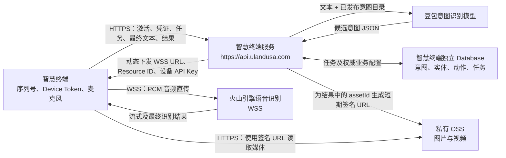
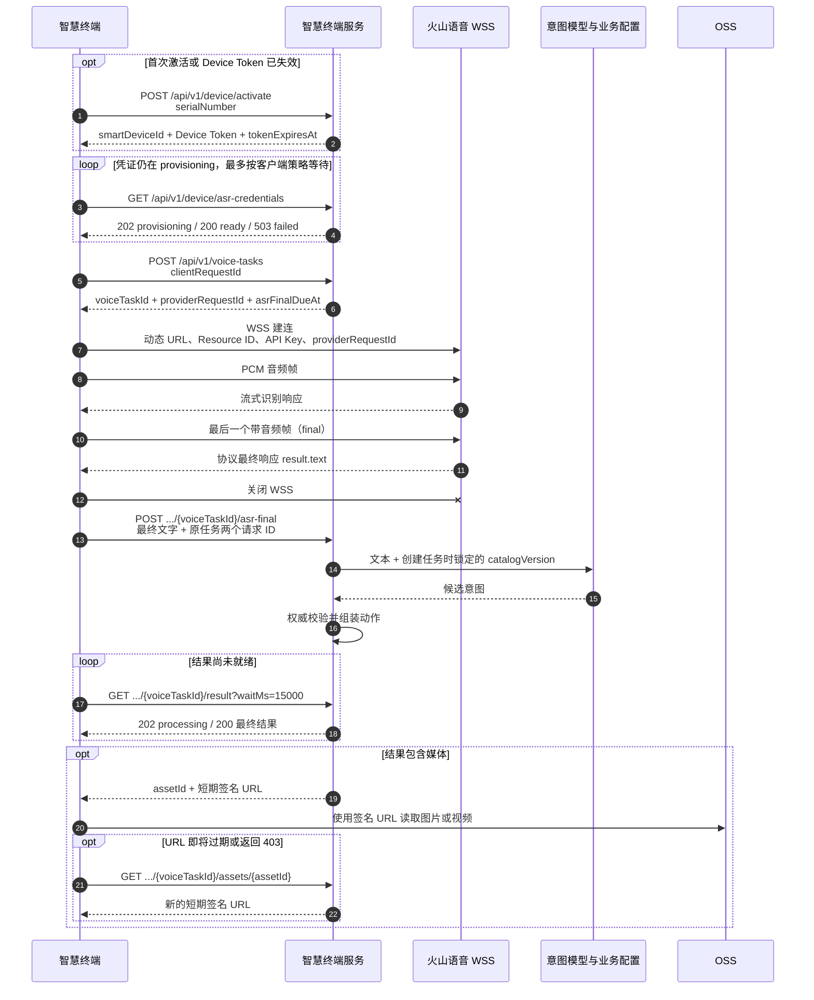

# 智慧终端生产版 API 对接文档

> 文档版本：1.0
>
> 对应接口版本：Device API `v1`、`interaction-result-v1`、`interaction-plan-v1`
>
> 生产主地址：`https://api.ulandusa.com`
>
> 最后更新：2026-07-20

## 1. 文档适用范围

本文面向智慧终端固件、Android 客户端及其他终端客户端开发人员，说明生产环境中以下完整链路：

```text
设备序列号激活
  → 获取设备专属火山语音凭证
  → 创建服务端语音任务
  → 终端直连火山引擎 WSS 上传音频
  → 向本服务上报最终识别文本
  → 查询大模型意图识别结果
  → 展示图片、播放视频或触发需确认的操作
```

智慧终端与项目中已有的扫码终端是两个独立产品。不得复用扫码终端的认证信息、接口地址、应用存储空间或业务协议。

### 1.1 最重要的系统边界

- 本项目服务端不接收、不转发语音音频。
- 终端通过 HTTPS 从本服务获取动态语音连接参数，再直接通过 WSS 把音频发送给火山引擎。
- 本服务只接收最终识别文本、语言代码，以及可选的受限大小供应商最终 JSON。
- 火山语音 API Key 是按智慧终端设备分配的临时业务凭证，不是火山 IAM 的 AK/SK，也不是方舟大模型 API Key。
- 终端只允许访问 `https://api.ulandusa.com/api/v1/*`。其他路径不属于公开设备接口。

### 1.2 架构图



## 2. 五分钟接入总览

终端每轮语音交互应按以下顺序执行：

1. 首次使用时，调用激活接口，用预导入的设备序列号换取 Device Token。
2. 用 Device Token 查询 ASR 凭证，直到状态为 `ready`。
3. 为本轮交互生成一个新的 `clientRequestId`，调用创建语音任务接口。
4. 使用服务端返回的 `providerRequestId`，以及凭证接口返回的 WSS 参数，直连火山引擎。
5. 采集并发送 PCM 音频，发送且仅发送一个带最终标志的音频帧。
6. 收到火山协议最终响应后，提取 `result.text` 并立即关闭 WSS。
7. 调用 `asr-final` 接口上报最终文本。
8. 使用同一个 `voiceTaskId` 长轮询结果，直至获得 `200` 终态结果。
9. 只执行终端白名单内的动作；媒体签名 URL 过期时通过 `assetId` 刷新。



## 3. 术语与 ID

以下 ID 用途不同，不得互换：

| 名称 | 生成方 | 生命周期 | 用途 |
|---|---|---|---|
| `smartDeviceId` | 本服务 | 设备级、长期 | 服务端设备主键；可作为火山请求中的 `uid` / `did` |
| `X-Request-Id` | 终端可选；缺失时由服务端生成 | 单次 HTTP 请求 | 日志链路追踪，不提供业务幂等 |
| `clientRequestId` | 终端 | 单个语音任务 | 创建任务的设备内幂等键，建议使用 UUID |
| `voiceTaskId` | 本服务 | 单个语音任务 | 本服务任务主键，用于路径参数和结果查询 |
| `providerRequestId` | 本服务 | 单个语音任务 | 火山 WSS 的 `X-Api-Request-Id` |
| `X-Api-Connect-Id` | 终端 | 单次 WSS 连接 | 每次建连都生成新 UUID；发生凭证回退时也必须重新生成 |
| `catalogVersion` | 本服务 | 意图配置版本 | 任务创建时锁定；同一任务后续始终使用该版本 |
| `assetId` | 本服务 | 媒体业务标识 | 刷新媒体短期签名 URL；不得使用 URL 代替 |

特别注意：

- 终端只生成 `clientRequestId`、可选的 HTTP `X-Request-Id` 和每次连接的 `X-Api-Connect-Id`。
- `voiceTaskId` 与 `providerRequestId` 必须使用创建任务接口的返回值。
- 不要把 `clientRequestId` 填入 URL 中的 `{voiceTaskId}`，也不要自行生成 `providerRequestId`。

## 4. 公共 HTTP 约定

### 4.1 Base URL

生产环境只使用：

```text
https://api.ulandusa.com
```

Release 版本终端必须：

- 只接受 HTTPS Base URL；
- 校验证书和主机名；
- 拒绝带用户名、密码、路径、查询参数或 fragment 的 Base URL；
- 不允许用户绕过 TLS 证书错误。

### 4.2 编码与格式

| 项目 | 约定 |
|---|---|
| 请求/响应编码 | UTF-8 |
| JSON Content-Type | `application/json; charset=utf-8` |
| 时间 | RFC 3339 / ISO 8601，示例：`2026-07-20T08:30:00Z` |
| UUID | 标准带连字符形式，建议小写 |
| JSON 字段 | 大小写敏感，使用 lowerCamelCase |
| 单个请求体 | 必须不超过 512 KiB；网关或服务端可能直接拒绝超限请求 |

### 4.3 公共请求头

```http
Accept: application/json
Content-Type: application/json; charset=utf-8
X-Locale: zh-HK
X-Request-Id: <HTTP_REQUEST_UUID>
Authorization: Bearer <DEVICE_TOKEN>
```

| 请求头 | 是否必填 | 说明 |
|---|---|---|
| `Accept` | 建议 | 固定为 `application/json` |
| `Content-Type` | 有 JSON Body 时必填 | 固定为 `application/json; charset=utf-8` |
| `X-Locale` | 建议 | 当前支持终端使用 `zh-HK`、`zh-CN`、`en-US`；用户文案仍由终端根据 key 本地化 |
| `X-Request-Id` | 可选 | 建议每次 HTTP 尝试使用一个新 UUID；最长 128 字节。服务端总会在响应头返回最终采用的值 |
| `Authorization` | 除激活接口外必填 | 格式必须为 `Bearer <deviceToken>` |

`X-Request-Id` 只用于排障。网络重试仍必须依赖对应接口的业务幂等机制。

### 4.4 统一响应包络

成功响应：

```json
{
  "code": "ok",
  "data": {}
}
```

失败响应：

```json
{
  "code": "device_token_invalid",
  "messageKey": "device.auth.invalid"
}
```

字段说明：

| 字段 | 类型 | 说明 |
|---|---|---|
| `code` | string | `ok` 表示请求成功；其他值为稳定业务错误码 |
| `messageKey` | string，可选 | 本地化键，不是可直接展示给用户的文案 |
| `data` | object，可选 | 成功数据；个别错误（例如凭证创建失败）也会携带状态数据 |

客户端必须同时判断 HTTP 状态码和 `code`：

- 不能把所有非 `200` 都当成失败，例如任务创建成功是 `201`、最终文本受理成功是 `202`。
- 凭证接口的 `202` 表示仍在初始化，`503` 表示初始化失败。
- 结果接口的 `202` 表示任务仍在处理，不是错误。
- 不得把 `messageKey` 原样展示给用户；未知 key 使用本地安全兜底文案。
- 响应新增未知字段时必须忽略；必填字段缺失、类型错误或未知 schema 版本应判定为协议不兼容。

## 5. 设备激活与 Device Token

### 5.1 当前认证阶段说明

当前生产测试阶段采用“后台预导入序列号 + HTTPS 激活”。它适合真实链路测试，但不是量产级防克隆认证：

- 序列号只通过 HTTPS 获得传输加密，没有额外的应用层加密。
- 知道有效序列号的人仍可能在其他设备上发起激活。
- 正式量产前应评估设备证书、硬件安全区密钥、一次性激活码或设备签名挑战。

### 5.2 激活接口

```http
POST /api/v1/device/activate
```

认证：不需要 Device Token。

请求：

```json
{
  "serialNumber": "<PRE_IMPORTED_SERIAL_NUMBER>"
}
```

| 字段 | 类型 | 必填 | 限制 |
|---|---|---|---|
| `serialNumber` | string | 是 | 去除首尾空白后必须非空，UTF-8 最长 128 字节；大小写及中间字符保持不变 |

序列号必须已经由管理人员导入且设备状态为启用。比较时大小写敏感。

成功：`HTTP 200`

```json
{
  "code": "ok",
  "data": {
    "smartDeviceId": "11111111-2222-4333-8444-555555555555",
    "deviceToken": "<DEVICE_TOKEN>",
    "tokenExpiresAt": "2026-07-21T08:30:00Z",
    "credentialStatus": "provisioning"
  }
}
```

`credentialStatus` 通常为：

- `provisioning`：设备专属火山 API Key 正在创建；
- `ready`：已有可用 API Key。

### 5.3 激活行为与限流

- 首次成功激活会在服务端记录激活时间并创建凭证任务。
- 同一序列号再次激活会返回同一个 `smartDeviceId`，但签发新的 Device Token；不会重复创建同一批凭证任务。
- 激活按可信来源 IP 限制为每分钟最多 20 次。终端不得通过更换序列号绕过限流。
- JSON 中缺失 `serialNumber` 或传入空字符串会返回 `400 request_invalid`。通过 JSON 必填校验后，仅含空白、超长、未知、未导入或禁用的序列号统一返回 `404 device_not_available`，不会说明是哪一种原因，以防止序列号枚举。

### 5.4 Device Token 生命周期

- Device Token 对客户端而言是不透明 Bearer Token；不得解析并依赖其内部格式。
- 当前有效期为 24 小时，服务端配置强制不得超过 24 小时；以 `tokenExpiresAt` 为准。
- 当前没有 Token 刷新接口。Token 到期后必须清除本地会话，并重新使用序列号调用激活接口。
- 收到 `401`、`device_token_invalid` 或 `device_disabled` 时立即停止本轮交互、关闭麦克风和 WSS、清除本地会话并回到激活页。
- `device_disabled` 表示后台已禁用设备，不能仅靠再次激活恢复，应提示联系运营人员。

终端应只把以下会话数据放进系统安全存储：

- Base URL；
- `smartDeviceId`；
- Device Token；
- `tokenExpiresAt`；
- 可选的凭证状态提示。

Android 推荐使用 Android Keystore 保护的 AES-256-GCM 信封。不得持久化序列号、火山 API Key、音频、供应商原始响应或媒体签名 URL。

## 6. 获取与轮换火山语音凭证

### 6.1 查询凭证

```http
GET /api/v1/device/asr-credentials
Authorization: Bearer <DEVICE_TOKEN>
```

该响应包含敏感 API Key，服务端会返回 `Cache-Control: no-store`。终端也不得缓存到磁盘。

公共数据结构：

| 字段 | 类型 | 必填 | 说明 |
|---|---|---|---|
| `status` | string | 是 | `provisioning`、`ready` 或 `failed` |
| `websocketUrl` | string | 是 | 火山 WSS 完整地址，必须动态使用 |
| `resourceId` | string | 是 | 火山资源 ID，必须动态使用 |
| `recognitionMode` | string | 是 | `async` 或 `nostream` |
| `current` | object | 条件必填 | 当前凭证；`ready` 时必须存在 |
| `next` | object | 否 | 轮换中的下一版本凭证 |
| `retryAfterMs` | integer | 否 | `provisioning` 时建议等待时间 |
| `errorCode` | string | 否 | `failed` 时的安全诊断码 |

凭证对象：

| 字段 | 类型 | 说明 |
|---|---|---|
| `version` | integer | 正整数版本号，用于 ACK |
| `apiKey` | string | 设备专属火山语音 API Key，仅保存在内存中 |
| `expiresAt` | string，可选 | 凭证到期时间；终端不得自行推算 |

#### provisioning：`HTTP 202`

```json
{
  "code": "ok",
  "data": {
    "status": "provisioning",
    "websocketUrl": "wss://openspeech.bytedance.com/api/v3/sauc/bigmodel_nostream",
    "resourceId": "volc.seedasr.sauc.duration",
    "recognitionMode": "nostream",
    "retryAfterMs": 1000
  }
}
```

终端应按 `retryAfterMs` 查询，建议把过小值提升到至少 250 ms，并设置客户端总等待上限。当前 APK 基线为最多等待 120 秒；超时后提示可重试，不要打开 WSS。

#### ready：`HTTP 200`

```json
{
  "code": "ok",
  "data": {
    "status": "ready",
    "websocketUrl": "wss://openspeech.bytedance.com/api/v3/sauc/bigmodel_nostream",
    "resourceId": "volc.seedasr.sauc.duration",
    "recognitionMode": "nostream",
    "current": {
      "version": 7,
      "apiKey": "<CURRENT_VOLC_DEVICE_API_KEY>",
      "expiresAt": "2026-08-18T08:30:00Z"
    },
    "next": {
      "version": 8,
      "apiKey": "<NEXT_VOLC_DEVICE_API_KEY>",
      "expiresAt": "2026-09-10T08:30:00Z"
    }
  }
}
```

#### failed：`HTTP 503`

```json
{
  "code": "credential_unavailable",
  "messageKey": "credential.unavailable",
  "data": {
    "status": "failed",
    "websocketUrl": "wss://openspeech.bytedance.com/api/v3/sauc/bigmodel_nostream",
    "resourceId": "volc.seedasr.sauc.duration",
    "recognitionMode": "nostream",
    "retryAfterMs": 1000,
    "errorCode": "<SAFE_PROVIDER_ERROR_CODE>"
  }
}
```

`failed` 时不要尝试 WSS。允许用户稍后重新获取；持续失败需把本服务响应头 `X-Request-Id` 提供给服务端人员。

### 6.2 凭证选择、回退与 ACK

每次新建 WSS 应执行以下算法：

```text
if next 存在:
    使用 next 建立新 WSS，并为本次连接生成新的 X-Api-Connect-Id
    if 建连成功且初始请求帧已发送:
        POST ACK(next.version)
        继续使用已打开的 WSS
    else if HTTP 状态为 401 或 403 且 current 存在:
        不 ACK next
        使用 current 再尝试一次，并生成新的 X-Api-Connect-Id
    else:
        本轮失败，不自动回退或无限重连
else:
    使用 current 建连
```

只允许在 `next` 的 WSS 建连返回 401/403 时回退一次。超时、协议错误、网络断开等情况不能自动换成 `current`，否则容易掩盖真实故障并重复创建会话。

### 6.3 确认凭证切换

```http
POST /api/v1/device/asr-credentials/ack
Authorization: Bearer <DEVICE_TOKEN>
Content-Type: application/json; charset=utf-8
```

请求：

```json
{
  "version": 8
}
```

成功：`HTTP 200`

```json
{
  "code": "ok",
  "data": {
    "acknowledgedVersion": 8
  }
}
```

ACK 成功后，服务端把 `next` 提升为 `current`，旧 `current` 进入宽限期。当前部署基线是 Key 有效期 30 天、提前 7 天轮换、旧 Key 宽限 24 小时；终端不能硬编码这些时长，必须以响应中的版本和 `expiresAt` 为准。

ACK 不是可盲目重复的幂等操作。如果 ACK 响应丢失，重试可能返回 `409 credential_not_switchable`。此时重新 GET 凭证：若该版本已经成为 `current`，可视为切换已完成；否则保留警告并在下一轮重新协调。

## 7. 创建语音任务

```http
POST /api/v1/voice-tasks
Authorization: Bearer <DEVICE_TOKEN>
Content-Type: application/json; charset=utf-8
```

普通任务请求：

```json
{
  "clientRequestId": "aaaaaaaa-bbbb-4ccc-8ddd-eeeeeeeeeeee"
}
```

| 字段 | 类型 | 必填 | 限制 |
|---|---|---|---|
| `clientRequestId` | string | 是 | 去除首尾空白后非空、合法 UTF-8、最长 128 字节；建议 UUID |
| `retryOfVoiceTaskId` | string | 否 | 只用于 `unknown` / `ambiguous` 的一次澄清重试，见第 13 节 |

成功：`HTTP 201`

```json
{
  "code": "ok",
  "data": {
    "voiceTaskId": "bbbbbbbb-cccc-4ddd-8eee-ffffffffffff",
    "clientRequestId": "aaaaaaaa-bbbb-4ccc-8ddd-eeeeeeeeeeee",
    "providerRequestId": "cccccccc-dddd-4eee-8fff-000000000000",
    "catalogVersion": "dish-production-v3",
    "state": "recognizing",
    "asrFinalDueAt": "2026-07-20T08:40:00Z"
  }
}
```

### 7.1 幂等规则

`clientRequestId` 在同一设备内唯一。相同 Device Token 对应的设备使用同一个 `clientRequestId` 重复创建时，服务端返回首次创建的任务上下文，HTTP 状态仍为 `201`。

客户端建议：

- 每一轮新的用户语音生成新的 UUID；
- 请求发出前保存到本轮内存状态；
- 仅在网络错误、未收到可解析响应时自动补发一次；
- 补发必须使用完全相同的 Body；
- 不要通过改变 `clientRequestId` 来“重试”响应丢失，否则会创建两个任务。

### 7.2 配置版本锁定

服务端在创建任务时选择当时最新发布的意图目录，并把版本写入 `catalogVersion`。之后 Admin 发布新版意图配置：

- 已创建任务继续使用原 `catalogVersion`；
- 新创建任务使用新发布版本；
- 终端不得自行选择或覆盖 `catalogVersion`。

### 7.3 ASR 最终结果截止时间

当前服务端默认给终端 10 分钟上报最终识别结果，但必须以每次返回的 `asrFinalDueAt` 为准。在该时间之后上报会得到 `409 asr_final_expired`，任务最终结果变为 `expired`。

## 8. 终端直连火山引擎 WSS

本节属于火山第三方协议与当前 APK 已验证基线，不是 `api.ulandusa.com` 的 WebSocket 接口。终端必须使用凭证接口动态下发的连接参数，不能把 WSS URL、Resource ID 或 API Key 写死在固件中。

### 8.1 WSS 请求头

```http
GET <websocketUrl> HTTP/1.1
Upgrade: websocket
Connection: Upgrade
X-Api-Key: <selectedCredential.apiKey>
X-Api-Resource-Id: <credentialBundle.resourceId>
X-Api-Request-Id: <voiceTask.providerRequestId>
X-Api-Connect-Id: <NEW_UUID_FOR_EACH_CONNECTION>
X-Api-Sequence: -1
```

映射关系：

| 火山请求头 | 值来源 |
|---|---|
| `X-Api-Key` | 凭证接口的 `next.apiKey` 或 `current.apiKey` |
| `X-Api-Resource-Id` | 凭证接口的 `resourceId` |
| `X-Api-Request-Id` | 创建任务返回的 `providerRequestId` |
| `X-Api-Connect-Id` | 终端为本次 WSS 新生成的 UUID |
| `X-Api-Sequence` | 固定 `-1` |

记录火山响应头 `X-Tt-Logid` 用于排障，但不得与 API Key 一起写日志。

### 8.2 当前已验证的初始请求

以下是当前 Android Demo 使用的请求结构。`uid` / `did` 使用 `smartDeviceId`，不得使用或暴露序列号：

```json
{
  "user": {
    "uid": "<SMART_DEVICE_ID>",
    "did": "<SMART_DEVICE_ID>",
    "platform": "Android",
    "sdk_version": "<TERMINAL_SDK_VERSION>",
    "app_version": "<TERMINAL_APP_VERSION>"
  },
  "audio": {
    "format": "pcm",
    "codec": "raw",
    "rate": 16000,
    "bits": 16,
    "channel": 1
  },
  "request": {
    "model_name": "bigmodel",
    "ssd_version": "200",
    "enable_itn": true,
    "enable_punc": true,
    "enable_ddc": false,
    "enable_lid": true,
    "show_utterances": true,
    "result_type": "full",
    "enable_auto_lang": true,
    "end_window_size": 800,
    "output_zh_variant": "hk"
  }
}
```

上例是 `recognitionMode=nostream` 且终端语言为 `zh-HK` 时的示例。不同模式必须按下一节过滤字段。

### 8.3 recognitionMode 参数矩阵

终端以服务端返回的 `recognitionMode` 为准：

| 参数 | `async` | `nostream` | 说明 |
|---|---:|---:|---|
| `enable_nonstream` | 允许 | 禁止发送 | 双向流式优化版的二遍/非流式结果能力 |
| `enable_auto_lang` | 禁止发送 | 允许 | 自动语种识别；已开通对应能力后使用 |
| `enable_lid` | 允许 | 允许 | 返回语种检测信息 |
| `show_utterances` | 允许 | 允许 | 开启 LID 时应为 `true`，用于读取分句 additions |
| `end_window_size` | 条件发送 | 条件发送 | 只在本模式已开启兼容的自动断句/语种能力时发送 |
| `enable_itn` | 允许 | 允许 | 数字、日期等文本规范化 |
| `enable_punc` | 允许 | 允许 | 标点 |
| `enable_ddc` | 允许 | 允许 | 语义顺滑相关开关，当前基线默认关闭 |
| `output_zh_variant=hk` | 允许 | 允许 | 终端显示语言为 `zh-HK` 时控制繁体字形，与音频语种识别独立 |

不得同时发送 `enable_nonstream` 和 `enable_auto_lang`。即使 UI 已禁用不兼容选项，请求构建层也必须再次按模式过滤。

向后兼容时，如果旧服务端没有返回 `recognitionMode`，只可从 WSS 路径末尾精确推断：

- `/bigmodel_async` → `async`；
- `/bigmodel_nostream` → `nostream`。

无法唯一推断时必须停止，不要猜测模式。

`end_window_size` 的当前请求构建条件为：

- `async`：`enable_nonstream=true` 或 `enable_lid=true` 时发送；
- `nostream`：`enable_auto_lang=true` 或 `enable_lid=true` 时发送；
- 上述条件都不满足时不发送该字段。

### 8.4 音频格式与二进制帧基线

当前链路验证的音频格式：

| 项目 | 值 |
|---|---|
| 采样率 | 16,000 Hz |
| 位深 | 16-bit signed PCM |
| 字节序 | little-endian PCM sample |
| 声道 | 单声道 |
| 编码 | raw PCM |
| 常规音频块 | 6,400 字节，即 200 ms |

火山二进制协议基线：

- 使用 4 字节基础 Header；
- Full client request 的序列化方式为 JSON，音频帧无序列化；
- Full request 和每个音频 payload 均使用 gzip；
- payload 长度使用 4 字节大端整数；
- 最后一个带音频的帧设置 final flag `0b0010`，并且只能发送一次；
- final 帧之后禁止再发送音频；
- 当前客户端把解压后的服务端 payload 限制为最多 1 MiB，超限或格式异常立即关闭会话。

为了保证最后一帧仍带有音频，建议始终暂存一个未发送音频块：收到下一块时发送上一块，结束时把最后暂存块作为 final 帧发送。没有采集到有效音频时不要发送空 final 帧。

完整帧格式必须以[火山引擎大模型流式语音识别官方文档](https://www.volcengine.com/docs/6561/1354869?lang=zh)为准。

### 8.5 最终结果判定

必须以火山二进制协议响应 Header 的 final flag 判定最终结果：

- `utterances[].definite=true` 只代表某个分句稳定，不代表整条 WSS 会话结束；
- 最终文字读取协议最终响应中的 `result.text`；
- 最终文字为空视为识别失败，不上报空任务；
- 收到最终响应后立即关闭 WSS，随后再执行 REST 上报和结果轮询；
- 当前 APK 在发送 final 音频帧后最多等待最终响应 20 秒。

### 8.6 语种检测结果上报

开启 LID 时，只从 `definite=true` 分句的 `additions.lid_lang` 读取经过长度和字符白名单校验的标签。当前 Demo 映射如下：

| 火山标签 | 上报 `language` |
|---|---|
| `speech_mand`、`singing_mand` | `zh-CN` |
| `speech_en`、`singing_en` | `en-US` |
| `singing_dia_cant` | `yue-CN` |
| 未知、缺失或非法标签 | `und` |

如果未开启 LID，使用终端 UI/API 语言作为回退值。开启自动语种识别时，不要把 UI locale 强行放入 `audio.language`，否则可能与自动识别冲突。

### 8.7 自动断句、自动停止与降噪

这些能力分属不同层，不能混为服务端功能：

| 能力 | 所在层 | 当前 Demo 基线 |
|---|---|---|
| 火山智能分句/端点 | 火山 WSS 请求 | 按模式发送兼容参数；`end_window_size` 默认 800 ms |
| 本地自动停止 | 终端 PCM VAD | 至少检测 300 ms 有效语音；尾部静音默认 1,200 ms 后停止 |
| 本地声音阈值 | 终端 PCM VAD | 默认 -42 dBFS，可配置范围 -70 至 -20 dBFS |
| Noise Suppressor | Android 音频会话 | 默认请求开启，设备不支持时继续原始录音 |
| Acoustic Echo Canceler | Android 音频会话 | 默认关闭，可选 |
| Automatic Gain Control | Android 音频会话 | 默认关闭，可选 |

本地设置建议范围：

- `end_window_size`：200～5,000 ms；
- 尾部静音：400～5,000 ms；
- 声音阈值：-70～-20 dBFS；
- 纯静音或不足 300 ms 的短噪声不得作为有效语音上报。

NS/AEC/AGC 必须绑定当前 `AudioRecord.audioSessionId`。创建、启用或设备能力检测失败只记录 `unsupported` / `failed`，不能导致原始 PCM 采集失败；所有已创建效果必须在 `finally` 中释放。

上述设置是终端本地非敏感配置，不需要也不允许通过当前服务端设备 API 保存。

## 9. 上报最终识别结果

```http
POST /api/v1/voice-tasks/{voiceTaskId}/asr-final
Authorization: Bearer <DEVICE_TOKEN>
Content-Type: application/json; charset=utf-8
```

请求示例：

```json
{
  "clientRequestId": "aaaaaaaa-bbbb-4ccc-8ddd-eeeeeeeeeeee",
  "providerRequestId": "cccccccc-dddd-4eee-8fff-000000000000",
  "text": "我想了解一下牛肉面",
  "language": "zh-CN",
  "providerFinal": {
    "result": {
      "text": "我想了解一下牛肉面"
    },
    "diagnostic": "bounded-example"
  }
}
```

| 字段 | 类型 | 必填 | 限制与来源 |
|---|---|---|---|
| 路径 `voiceTaskId` | string | 是 | 创建任务返回值 |
| `clientRequestId` | string | 是 | 必须等于该任务创建请求中的值 |
| `providerRequestId` | string | 是 | 必须等于创建任务返回值 |
| `text` | string | 是 | 去除首尾空白后非空、合法 UTF-8、最多 16 KiB |
| `language` | string | 否 | 最多 32 字节；空值默认 `zh-CN`；自动语种未知时建议 `und` |
| `providerFinal` | 任意合法 JSON | 否 | 最多 256 KiB；建议传对象，不要传“包含 JSON 的字符串” |

最简单的合法请求可以省略 `providerFinal`：

```json
{
  "clientRequestId": "aaaaaaaa-bbbb-4ccc-8ddd-eeeeeeeeeeee",
  "providerRequestId": "cccccccc-dddd-4eee-8fff-000000000000",
  "text": "我想了解一下牛肉面",
  "language": "zh-CN"
}
```

如果供应商最终响应超过安全大小，终端应构造精简对象，只保留文本、序列号、Log ID、语种标签和 `truncated=true`。当前 APK 在 240 KiB 时提前截断，为服务端 256 KiB 限制预留包络空间。

成功：`HTTP 202`

```json
{
  "code": "ok",
  "data": {
    "status": "intent_processing"
  }
}
```

### 9.1 最终上报幂等规则

网络错误时可以补发一次，但必须保持相同路径和完全相同的 Body：

- 同一任务、相同最终文本且 `providerFinal` 原始 JSON 字节相同：重复请求成功；
- 文本不同，或同一文本但 `providerFinal` 不同：返回 `409 asr_final_conflict`；
- 三个任务身份值不匹配：返回 `409 voice_task_identity_mismatch`；
- 超过 `asrFinalDueAt`：返回 `409 asr_final_expired`。

不要因为 WSS 失败自动重放刚才的音频。让用户重新说话并创建新任务，避免在用户无感知时重复录音内容。

## 10. 查询意图处理结果

```http
GET /api/v1/voice-tasks/{voiceTaskId}/result?waitMs=15000
Authorization: Bearer <DEVICE_TOKEN>
```

| 参数 | 类型 | 必填 | 说明 |
|---|---|---|---|
| `voiceTaskId` | string | 是 | 创建任务返回值，且必须属于当前设备 |
| `waitMs` | integer | 否 | `0`～`15000`；缺省为 `0`，表示立即查询 |

### 10.1 仍在处理：`HTTP 202`

```json
{
  "code": "ok",
  "data": {
    "status": "processing",
    "retryAfterMs": 500
  }
}
```

终端应继续使用同一个 `voiceTaskId` 查询，不能新建任务。推荐单次使用 `waitMs=15000`，收到 `202` 后按 `retryAfterMs` 等待；当前 APK 把单轮前台总等待限制为 90 秒，之后显示“继续查询”，继续查询仍使用原任务 ID。

服务端当前限制：

- 每个设备最多同时保持 2 个结果等待请求；
- 同一任务最多同时保持 1 个结果等待请求；
- 超限返回 `429 long_poll_limit`。

确保上一条长轮询已经结束或取消后再发下一条，禁止并行堆积。

### 10.2 终态结果：`HTTP 200`

`data` 直接是 `interaction-result-v1`，外面没有额外的 `result` 字段：

```json
{
  "code": "ok",
  "data": {
    "schemaVersion": "interaction-result-v1",
    "voiceTaskId": "bbbbbbbb-cccc-4ddd-8eee-ffffffffffff",
    "catalogVersion": "dish-production-v3",
    "resultStatus": "succeeded"
  }
}
```

## 11. `interaction-result-v1` 结构

### 11.1 顶层字段

| 字段 | 类型 | 必填 | 说明 |
|---|---|---|---|
| `schemaVersion` | string | 是 | 当前必须为 `interaction-result-v1` |
| `voiceTaskId` | string | 是 | 应等于查询路径中的任务 ID |
| `catalogVersion` | string | 是 | 任务创建时锁定的意图目录版本 |
| `resultStatus` | string | 是 | `succeeded`、`failed` 或 `expired` |
| `decision` | object | 否 | 成功完成意图推断时存在 |
| `feedback` | object | 否 | 未匹配、歧义、未配置动作、失败或超时时存在 |
| `interactionPlan` | object | 否 | 匹配到已发布动作计划时存在 |

`resultStatus=succeeded` 只表示意图处理流水线正常完成，不代表一定匹配到意图。是否匹配必须继续判断 `decision.matchState`。

### 11.2 decision

```json
{
  "matchState": "matched",
  "intentCode": "dish.introduce",
  "slots": {
    "dishId": "dish_beef_noodles"
  },
  "entities": [
    {
      "entityType": "dish",
      "entityId": "dish_beef_noodles"
    }
  ]
}
```

| `matchState` | 含义 | 终端行为 |
|---|---|---|
| `matched` | 意图与实体通过服务端权威校验 | 只执行返回计划中白名单动作 |
| `unknown` | 无法归入已发布意图 | 根据 `feedback.retryAllowed` 提示用户重说或结束 |
| `ambiguous` | 存在多个可能解释 | 根据 `feedback.retryAllowed` 提示用户澄清或结束 |

`slots` 和 `entities` 是服务端授权后的业务引用。不得根据模型原始文字自行构造动作。

### 11.3 feedback

```json
{
  "messageKey": "voice.intent.unknown_retry",
  "retryAllowed": true
}
```

当前可能出现的结果文案键：

| `messageKey` | 含义 |
|---|---|
| `voice.intent.unknown_retry` | 未识别，可澄清一次 |
| `voice.intent.unknown_end` | 澄清后仍未识别，结束 |
| `voice.intent.ambiguous_retry` | 意图歧义，可澄清一次 |
| `voice.intent.ambiguous_end` | 澄清后仍歧义，结束 |
| `voice.intent.unconfigured` | 意图已匹配，但当前目录没有对应动作计划 |
| `voice.error.intent_processing` | 意图处理最终失败 |
| `voice.error.asr_timeout` | 未在截止时间前收到最终 ASR |

终端需在本地为这些 key 提供繁体中文、简体中文和英文文案。未知 key 只能显示通用提示，不能直接展示内部键。

### 11.4 完整成功结果示例

以下示例展示“介绍牛肉面”同时配置图片、视频和下单操作时的完整结构：

```json
{
  "code": "ok",
  "data": {
    "schemaVersion": "interaction-result-v1",
    "voiceTaskId": "bbbbbbbb-cccc-4ddd-8eee-ffffffffffff",
    "catalogVersion": "dish-production-v3",
    "resultStatus": "succeeded",
    "decision": {
      "matchState": "matched",
      "intentCode": "dish.introduce",
      "slots": {
        "dishId": "dish_beef_noodles"
      },
      "entities": [
        {
          "entityType": "dish",
          "entityId": "dish_beef_noodles"
        }
      ]
    },
    "interactionPlan": {
      "schemaVersion": "interaction-plan-v1",
      "voiceTaskId": "bbbbbbbb-cccc-4ddd-8eee-ffffffffffff",
      "decision": {
        "matchState": "matched",
        "intentCode": "dish.introduce",
        "slots": {
          "dishId": "dish_beef_noodles"
        },
        "entities": [
          {
            "entityType": "dish",
            "entityId": "dish_beef_noodles"
          }
        ]
      },
      "presentationDirectives": [
        {
          "directiveId": "10000000-0000-4000-8000-000000000001",
          "type": "SHOW_IMAGE",
          "executionMode": "auto",
          "sequence": 10,
          "payload": {
            "assetId": "20000000-0000-4000-8000-000000000001",
            "url": "https://oss.example.invalid/image.jpg?<SIGNED_QUERY>",
            "expiresAt": "2026-07-20T09:35:00Z",
            "mimeType": "image/jpeg",
            "sizeBytes": 345678,
            "contentHash": "aaaaaaaaaaaaaaaaaaaaaaaaaaaaaaaaaaaaaaaaaaaaaaaaaaaaaaaaaaaaaaaa"
          }
        },
        {
          "directiveId": "10000000-0000-4000-8000-000000000002",
          "type": "PLAY_VIDEO",
          "executionMode": "user_triggered",
          "sequence": 20,
          "payload": {
            "assetId": "20000000-0000-4000-8000-000000000002",
            "url": "https://oss.example.invalid/video.mp4?<SIGNED_QUERY>",
            "expiresAt": "2026-07-20T09:35:00Z",
            "mimeType": "video/mp4",
            "sizeBytes": 2345678,
            "contentHash": "bbbbbbbbbbbbbbbbbbbbbbbbbbbbbbbbbbbbbbbbbbbbbbbbbbbbbbbbbbbbbbbb"
          }
        }
      ],
      "availableOperations": [
        {
          "operationId": "30000000-0000-4000-8000-000000000001",
          "type": "START_ORDER",
          "labelKey": "dish.actions.order",
          "requiresConfirmation": true,
          "payload": {
            "dishId": "dish_beef_noodles"
          }
        }
      ]
    }
  }
}
```

### 11.5 动作白名单

终端当前只允许处理以下三类动作：

| 类型 | 所在数组 | 强制策略 |
|---|---|---|
| `SHOW_IMAGE` | `presentationDirectives` | 仅当 `executionMode=auto` 时可以自动加载；失败不影响下一轮交互 |
| `PLAY_VIDEO` | `presentationDirectives` | 必须为 `executionMode=user_triggered`，用户点击后才播放 |
| `START_ORDER` | `availableOperations` | 必须为 `requiresConfirmation=true`，本地二次确认后才交给终端自身业务模块 |

当前智慧终端 API 没有“提交订单”接口。`START_ORDER` 只提供已授权的 `dishId` 及本地展示信息；确认后的实际下单行为需由终端所属产品的订单模块另行定义。

动作执行规则：

- 按 `sequence` 升序处理展示指令；
- 只使用已解析的类型化 payload；
- 未知 `type`、不符合预期的 `executionMode`、缺失字段或未知 schema 必须失败关闭，即不执行动作；
- `operationId` / `directiveId` 可用于本地去重，但当前没有把它们回传给服务端的接口；
- 不根据 `intentCode` 或 `slots` 自行猜测一个未返回的动作。

## 12. 媒体签名 URL 与刷新

媒体 payload 中：

- `assetId` 是稳定业务标识；
- `url` 是私有 OSS 的短期签名地址，当前服务端签发有效期约 1 小时；
- `expiresAt` 是判断过期的权威时间；
- `contentHash` 为内容 SHA-256 标识，可用于诊断或缓存一致性检查；
- 终端访问 OSS 时不要附带 Device Token。

建议在 `expiresAt` 前 60 秒刷新。URL 过期、返回 HTTP 403，或用户稍后点击视频时，可调用：

```http
GET /api/v1/voice-tasks/{voiceTaskId}/assets/{assetId}
Authorization: Bearer <DEVICE_TOKEN>
```

服务端只会为“当前设备拥有的成功任务，并且该任务最终结果真实引用”的资产重新签名，不能凭 `assetId` 枚举其他媒体。

成功：`HTTP 200`

```json
{
  "code": "ok",
  "data": {
    "assetId": "20000000-0000-4000-8000-000000000001",
    "url": "https://oss.example.invalid/image.jpg?<NEW_SIGNED_QUERY>",
    "expiresAt": "2026-07-20T10:00:00Z",
    "mimeType": "image/jpeg",
    "sizeBytes": 345678,
    "contentHash": "aaaaaaaaaaaaaaaaaaaaaaaaaaaaaaaaaaaaaaaaaaaaaaaaaaaaaaaaaaaaaaaa"
  }
}
```

当前客户端策略：

- 图片自动加载，最多读取 30 MiB，并按设备屏幕尺寸降采样；
- 图片 HTTP 403 时自动刷新一次；
- 视频只在用户触发时准备 URL，播放失败后最多刷新一次；
- 媒体失败是非阻断错误，不得破坏已经获得的意图结果或下一轮语音交互；
- 任何复制到日志或诊断界面的 JSON 都必须递归把字段名为 `url` 的值替换为 `null`。

## 13. unknown / ambiguous 的一次澄清重试

第一次结果可能为：

```json
{
  "schemaVersion": "interaction-result-v1",
  "voiceTaskId": "<ORIGINAL_VOICE_TASK_ID>",
  "catalogVersion": "dish-production-v3",
  "resultStatus": "succeeded",
  "decision": {
    "matchState": "unknown"
  },
  "feedback": {
    "messageKey": "voice.intent.unknown_retry",
    "retryAllowed": true
  }
}
```

用户明确选择重说后，终端重新采集音频，并创建一个新任务：

```json
{
  "clientRequestId": "<NEW_CLIENT_REQUEST_UUID>",
  "retryOfVoiceTaskId": "<ORIGINAL_VOICE_TASK_ID>"
}
```

约束：

- 原任务必须属于当前设备；
- 原任务必须已成功结束，且 `matchState` 为 `unknown` 或 `ambiguous`；
- 原任务必须是第一次尝试；
- 每个原任务最多创建一个重试任务；
- 重试任务必须使用新的 `clientRequestId`，服务端会生成新的 `voiceTaskId` 和 `providerRequestId`；
- 第二次仍未匹配时 `retryAllowed=false`，终端结束本轮对话。

## 14. 推荐终端状态机

```text
NEEDS_ACTIVATION
  └─ activate → READY

READY
  └─ start → FETCHING_CREDENTIALS

FETCHING_CREDENTIALS
  ├─ provisioning → 延迟后继续获取
  ├─ failed → RETRYABLE_FAILURE
  └─ ready → CREATING_TASK

CREATING_TASK
  └─ 201 → CONNECTING_WSS

CONNECTING_WSS
  ├─ next 连接成功 → ACK → RECORDING
  ├─ next 返回 401/403 → current 仅回退一次 → RECORDING
  └─ 其他失败 → RETRYABLE_FAILURE

RECORDING
  ├─ 手动停止 / 30 秒上限 / 本地静音停止 → FINALIZING
  ├─ 页面进入后台 → 取消录音及 WSS
  └─ 无有效语音 → RETRYABLE_FAILURE，不上报 ASR final

FINALIZING
  ├─ 火山协议 final → 关闭 WSS → SUBMITTING_FINAL
  └─ 20 秒无 final / 协议错误 → RETRYABLE_FAILURE

SUBMITTING_FINAL
  └─ 202 → WAITING_RESULT

WAITING_RESULT
  ├─ 202 → 按 retryAfterMs 继续同一 task
  ├─ 200 → RESULT_READY / RESULT_FAILED / RESULT_EXPIRED
  └─ 客户端前台等待超时 → PENDING_RESULT，可继续查询同一 task
```

伪代码：

```text
session = activateOrRestoreSecureSession()
ensureNotExpired(session.tokenExpiresAt)

bundle = pollCredentials(maxClientWait = 120s)
taskIdempotencyKey = newUUID()
task = retryNetworkOnceSameBody(createTask(taskIdempotencyKey))

wss = openUsingNextOrCurrent(bundle, task.providerRequestId)
captureAndSendPcm(wss, maxRecording = 30s)
final = awaitProtocolFinal(wss, timeout = 20s)
wss.close()

language = mapDetectedLanguageOrFallback(final)
retryNetworkOnceSameBody(submitFinal(task, final.text, language, boundedRaw(final)))

result = pollSameTask(task.voiceTaskId, waitMs = 15000)
validateSchemaAndIds(result)
executeAllowlistedActions(result)
```

录音、WSS、计时器和媒体任务必须归属于当前 run。取消或上一轮迟到的回调不得更新新一轮 UI；捕获宽泛异常前必须先重新抛出取消异常。

## 15. 错误码与终端处置

### 15.1 公共认证与请求错误

| HTTP | `code` | `messageKey` | 终端处置 |
|---:|---|---|---|
| 400 | `request_invalid` | `common.request.invalid` | 修正 JSON、Content-Type 或必填字段；不要原样重试 |
| 401 | `device_token_required` | `device.auth.required` | 本地缺 Token，回到激活流程 |
| 401 | `device_token_invalid` | `device.auth.invalid` | 清除安全存储中的会话并重新激活 |
| 401 | `device_disabled` | `device.auth.disabled` | 清除会话、停止使用并联系运营人员 |
| 500 | `internal_error` | `common.internal_error` | 有限退避重试；持续失败携带 `X-Request-Id` 联系服务端 |

### 15.2 激活

| HTTP | `code` | 终端处置 |
|---:|---|---|
| 404 | `device_not_available` | 提示检查序列号或联系管理员；不得提示“该序列号存在/不存在”的细节 |
| 429 | `activation_rate_limited` | 停止连续尝试，至少跨过当前分钟窗口并指数退避 |
| 500 | `activation_failed` / `token_issue_failed` | 有限重试；持续失败联系服务端 |

### 15.3 凭证与 ACK

| HTTP | `code` | 终端处置 |
|---:|---|---|
| 503 | `credential_unavailable` | 不打开 WSS；稍后重新获取，持续失败联系服务端 |
| 409 | `credential_not_switchable` | 重新 GET 凭证并核对版本，不要无限重复 ACK |
| 409 | `credential_state_conflict` | 同上；视为轮换状态需要重新协调 |
| 500 | `credential_query_failed` / `credential_decrypt_failed` | 有限重试；持续失败联系服务端 |

### 15.4 创建任务

| HTTP | `code` | 终端处置 |
|---:|---|---|
| 400 | `client_request_id_invalid` | 生成合法非空且不超过 128 字节的 ID |
| 503 | `catalog_unavailable` | 当前没有可用发布目录；无需用户反复说话，联系服务端 |
| 409 | `voice_task_create_conflict` | 使用相同 `clientRequestId` 有限重试；持续失败联系服务端 |
| 404 | `voice_task_not_found` | `retryOfVoiceTaskId` 无效或不属于设备，停止重试 |
| 409 | `voice_retry_not_allowed` | 原结果不允许澄清重试，结束本轮 |
| 409 | `voice_retry_already_created` | 不能再创建第二个；优先恢复本地保存的首次重试任务 ID，若已丢失则结束本轮并重新开始普通交互 |

### 15.5 最终文字上报

| HTTP | `code` | 终端处置 |
|---:|---|---|
| 400 | `asr_text_invalid` | 不上报空文字；检查 UTF-8 和 16 KiB 限制 |
| 400 | `asr_payload_invalid` | 删除或缩减 `providerFinal`，保证是合法 JSON 且不超过 256 KiB |
| 400 | `asr_language_invalid` | 使用合法且不超过 32 字节的 BCP 47 风格代码或 `und` |
| 404 | `voice_task_not_found` | 检查路径是否误用了 `clientRequestId`，或任务是否属于当前设备 |
| 409 | `voice_task_identity_mismatch` | 检查三个 ID 来源，停止当前错误请求 |
| 409 | `asr_final_conflict` | 同一任务已经收到不同内容，不能覆盖；创建新一轮交互 |
| 409 | `asr_final_expired` | 查询该任务的 `expired` 结果，并让用户重新说话创建新任务 |

### 15.6 结果与媒体

| HTTP | `code` | 终端处置 |
|---:|---|---|
| 400 | `wait_ms_invalid` | 把 `waitMs` 修正到 0～15000 |
| 429 | `long_poll_limit` | 取消重复查询，确保同一任务只有一个活动长轮询后再试 |
| 404 | `voice_task_not_found` | 检查任务 ID 和设备会话，不要新建任务来掩盖问题 |
| 500 | `voice_result_missing` | 服务端终态数据不一致，联系服务端 |
| 404 | `voice_result_not_found` | 媒体刷新关联结果不存在，停止刷新 |
| 404 | `voice_asset_not_found` | 资产未被该任务引用、已失效或 ID 错误，不再重试 |
| 503 | `voice_asset_sign_failed` | 有限退避重试，媒体失败不阻断其他动作 |

### 15.7 业务错误码与 messageKey 对照

`messageKey` 供终端映射本地文案，不能直接显示。当前公开设备接口的稳定对应关系如下：

| `code` | `messageKey` |
|---|---|
| `request_invalid` | `common.request.invalid` |
| `internal_error` | `common.internal_error` |
| `device_token_required` | `device.auth.required` |
| `device_token_invalid` | `device.auth.invalid` |
| `device_disabled` | `device.auth.disabled` |
| `device_not_available` | `device.activation.unavailable` |
| `activation_rate_limited` | `device.activation.rate_limited` |
| `activation_failed` | `common.internal_error` |
| `token_issue_failed` | `common.internal_error` |
| `credential_unavailable` | `credential.unavailable` |
| `credential_query_failed` | `common.internal_error` |
| `credential_decrypt_failed` | `common.internal_error` |
| `credential_not_switchable` | `credential.ack.invalid` |
| `credential_state_conflict` | `credential.ack.invalid` |
| `client_request_id_invalid` | `voice.client_request_id.invalid` |
| `catalog_unavailable` | `voice.catalog.unavailable` |
| `voice_task_create_conflict` | `voice.task.conflict` |
| `voice_task_not_found` | `voice.task.not_found` |
| `voice_retry_not_allowed` | `voice.retry.not_allowed` |
| `voice_retry_already_created` | `voice.retry.already_created` |
| `asr_text_invalid` | `voice.asr_text.invalid` |
| `asr_payload_invalid` | `voice.asr_payload.invalid` |
| `asr_language_invalid` | `voice.asr_language.invalid` |
| `voice_task_identity_mismatch` | `voice.task.identity_mismatch` |
| `asr_final_conflict` | `voice.asr_final.conflict` |
| `asr_final_expired` | `voice.asr_final.expired` |
| `wait_ms_invalid` | `voice.wait.invalid` |
| `long_poll_limit` | `voice.wait.limit` |
| `voice_result_missing` | `common.internal_error` |
| `voice_result_not_found` | `voice.result.not_found` |
| `voice_asset_not_found` | `voice.asset.not_found` |
| `voice_asset_sign_failed` | `voice.asset.sign_failed` |

未来新增 key 时，旧终端必须显示通用本地错误提示并记录 `code`，不能把内部 key 暴露给终端用户。

### 15.8 HTTP 成功但业务终态失败

以下情况通过结果接口 `HTTP 200` 返回，不是错误包络：

```json
{
  "code": "ok",
  "data": {
    "schemaVersion": "interaction-result-v1",
    "voiceTaskId": "<VOICE_TASK_ID>",
    "catalogVersion": "dish-production-v3",
    "resultStatus": "failed",
    "feedback": {
      "messageKey": "voice.error.intent_processing",
      "retryAllowed": false
    }
  }
}
```

`resultStatus=expired` 对应 `voice.error.asr_timeout`。这两类都不得执行动作。

## 16. 重试与超时建议

| 环节 | 当前已验证客户端基线 | 重试原则 |
|---|---:|---|
| REST 连接 | 15 秒 | GET 可有限重试；写请求按幂等规则处理 |
| REST 单次调用 | 30 秒 | 不要无限挂起 |
| 凭证准备总等待 | 120 秒 | 按 `retryAfterMs`，超时后让用户重试 |
| WSS 建连 | 15 秒 | 只有 next 的 401/403 才回退 current 一次 |
| 单轮录音 | 最多 30 秒 | 手动、计时器、本地静音共用一个原子结束门 |
| final 响应 | 20 秒 | 超时关闭 WSS，不自动重放音频 |
| 单次结果长轮询 | 最多 15 秒 | 使用 `waitMs` 与 `retryAfterMs` |
| 前台结果总等待 | 90 秒 | 超时后保留同一任务并提供继续查询 |
| 媒体刷新提前量 | 60 秒 | 过期/403 最多刷新一次 |

写请求建议：

- 创建任务：网络失败时，相同 `clientRequestId` 和 Body 最多自动补发一次；
- 最终文字：网络失败时，相同路径和 Body 最多自动补发一次；
- ACK：响应丢失时先 GET 凭证协调状态，不要盲目循环；
- 激活：可以由用户重试，但要注意每来源 IP 的限流；
- WSS 音频：不自动重放。

## 17. 安全要求

### 17.1 禁止持久化或输出的内容

以下内容不得进入普通日志、崩溃上报、剪贴板、Analytics 或明文偏好存储：

- 设备序列号；
- Device Token；
- 火山设备 API Key（`current` / `next`）；
- 火山 IAM AK/SK、方舟 API Key 或其他服务端凭证；
- 音频 PCM；
- 完整 `providerFinal`；
- 用户完整识别文本，除非有明确隐私授权与脱敏策略；
- OSS 签名 URL 及其查询参数。

允许用于排障的非秘密信息：

- 本服务响应头 `X-Request-Id`；
- `voiceTaskId`；
- 脱敏后的 `clientRequestId`；
- 火山 `X-Tt-Logid`；
- HTTP 状态、业务 `code`、本地阶段及耗时；
- 凭证版本号，但不能记录 API Key。

### 17.2 终端运行安全

- 保持系统时间同步，否则 Token 和签名 URL 到期判断会失真。
- Release 禁止明文 HTTP 和任意证书信任。
- 只把 Device Token 放到 `api.ulandusa.com`，只把火山 API Key 放到服务端下发的火山 WSS 主机。
- 访问 OSS 签名 URL 时不要携带 Device Token 或火山 API Key。
- 进入后台时，如果仍在准备、录音或等待火山最终响应，应取消麦克风和 WSS；已经进入 REST 上报或结果轮询后可以在不占用麦克风的前提下继续。
- 每轮 run 必须拥有自己的录音器、WSS、计时器与回调；旧 run 迟到事件不能覆盖新 UI。

## 18. 完整 curl 联调演练

以下命令只演示本服务 REST 控制面。WSS 音频部分需使用终端实现或仓库中的 Android Demo。

先在本地终端环境中记录占位变量，切勿把真实值提交到代码仓库：

```text
BASE_URL=https://api.ulandusa.com
SERIAL_NUMBER=<PRE_IMPORTED_SERIAL_NUMBER>
DEVICE_TOKEN=<VALUE_FROM_ACTIVATION>
CLIENT_REQUEST_ID=<NEW_UUID>
VOICE_TASK_ID=<VALUE_FROM_TASK_CREATION>
PROVIDER_REQUEST_ID=<VALUE_FROM_TASK_CREATION>
```

### 18.1 激活

```bash
curl --fail-with-body \
  -X POST 'https://api.ulandusa.com/api/v1/device/activate' \
  -H 'Accept: application/json' \
  -H 'Content-Type: application/json; charset=utf-8' \
  -H 'X-Locale: zh-CN' \
  -H 'X-Request-Id: <NEW_HTTP_UUID>' \
  --data '{"serialNumber":"<PRE_IMPORTED_SERIAL_NUMBER>"}'
```

### 18.2 获取凭证

```bash
curl --fail-with-body \
  'https://api.ulandusa.com/api/v1/device/asr-credentials' \
  -H 'Accept: application/json' \
  -H 'X-Locale: zh-CN' \
  -H 'Authorization: Bearer <DEVICE_TOKEN>'
```

### 18.3 创建任务

```bash
curl --fail-with-body \
  -X POST 'https://api.ulandusa.com/api/v1/voice-tasks' \
  -H 'Accept: application/json' \
  -H 'Content-Type: application/json; charset=utf-8' \
  -H 'X-Locale: zh-CN' \
  -H 'Authorization: Bearer <DEVICE_TOKEN>' \
  --data '{"clientRequestId":"<NEW_CLIENT_REQUEST_UUID>"}'
```

保存响应中的 `voiceTaskId`、`providerRequestId` 和 `asrFinalDueAt`。接下来终端用 `providerRequestId` 直连火山 WSS，不能用 curl 把音频发给本服务。

### 18.4 模拟最终文字上报

```bash
curl --fail-with-body \
  -X POST 'https://api.ulandusa.com/api/v1/voice-tasks/<VOICE_TASK_ID>/asr-final' \
  -H 'Accept: application/json' \
  -H 'Content-Type: application/json; charset=utf-8' \
  -H 'X-Locale: zh-CN' \
  -H 'Authorization: Bearer <DEVICE_TOKEN>' \
  --data '{"clientRequestId":"<CLIENT_REQUEST_ID>","providerRequestId":"<PROVIDER_REQUEST_ID>","text":"我想了解一下牛肉面","language":"zh-CN"}'
```

### 18.5 查询结果

```bash
curl --fail-with-body \
  'https://api.ulandusa.com/api/v1/voice-tasks/<VOICE_TASK_ID>/result?waitMs=15000' \
  -H 'Accept: application/json' \
  -H 'X-Locale: zh-CN' \
  -H 'Authorization: Bearer <DEVICE_TOKEN>'
```

收到 `202` 时继续查询同一个 URL；收到 `200` 后先校验 `schemaVersion`、`voiceTaskId` 和动作白名单。

### 18.6 刷新媒体 URL

```bash
curl --fail-with-body \
  'https://api.ulandusa.com/api/v1/voice-tasks/<VOICE_TASK_ID>/assets/<ASSET_ID>' \
  -H 'Accept: application/json' \
  -H 'X-Locale: zh-CN' \
  -H 'Authorization: Bearer <DEVICE_TOKEN>'
```

## 19. 生产上线检查表

### 19.1 接口与认证

- [ ] Release Base URL 固定或校验为 `https://api.ulandusa.com`。
- [ ] 序列号只在激活时使用，去除首尾空白但保留大小写和中间字符。
- [ ] Device Token 使用系统安全存储，应用启动时检查 `tokenExpiresAt`。
- [ ] 401 / Token 无效 / 设备禁用会清除会话并释放本轮资源。
- [ ] HTTP `X-Request-Id`、`clientRequestId`、`voiceTaskId`、`providerRequestId` 和 WSS Connect ID 没有混用。

### 19.2 火山 WSS

- [ ] URL、Resource ID、Recognition Mode、API Key 全部来自凭证响应，没有硬编码。
- [ ] 新连接优先 next，只在 next 的 401/403 时回退 current 一次。
- [ ] next 建连成功后才 ACK；ACK 不确定时通过 GET 凭证协调。
- [ ] PCM 为 16 kHz、16-bit、单声道，常规块 6,400 字节。
- [ ] final 音频帧只发送一次，且只用协议 final flag 判定最终结果。
- [ ] `async` / `nostream` 模式专属参数经过请求层白名单过滤。
- [ ] WSS 结束后先关闭连接，再进行 REST 上报和轮询。

### 19.3 任务与结果

- [ ] 创建任务和最终上报的网络补发保持相同 ID 与 Body。
- [ ] 上报发生在 `asrFinalDueAt` 之前，文本与原始 JSON 大小受限。
- [ ] 结果轮询没有并发堆积，90 秒等客户端上限后仍保留原任务。
- [ ] 只接受已支持的 schema；响应新增未知字段不会导致崩溃。
- [ ] `SHOW_IMAGE`、`PLAY_VIDEO`、`START_ORDER` 以外的动作全部拒绝执行。
- [ ] START_ORDER 必须二次确认，当前不会误调用一个不存在的服务端下单接口。
- [ ] 媒体 URL 在内存中使用，过期或 403 时最多刷新一次。

### 19.4 隐私与稳定性

- [ ] 日志、崩溃上报和诊断复制内容不包含任何 Token、API Key、音频、完整原始响应或签名 URL。
- [ ] 终端系统时间保持同步。
- [ ] 进入后台、取消、超时和异常路径都释放麦克风、WSS、音效和计时器。
- [ ] 纯静音不会创建有意义的最终上报。
- [ ] NS/AEC/AGC 不受支持时仍可继续原始 PCM 录音。
- [ ] 已记录当前“序列号 + HTTPS”只是生产测试阶段认证例外，量产前有独立的设备身份加固计划。

## 20. 参考资料与变更原则

- [火山引擎：大模型流式语音识别 API](https://www.volcengine.com/docs/6561/1354869?lang=zh)
- [项目内智慧终端服务实现说明](./smart-terminal-service.md)
- [项目内智慧终端 Android Demo](../smart-terminal-demo/README.md)

火山 WSS 是第三方协议，可能独立升级；本项目 REST API 与结果 schema 则按版本管理。终端升级原则：

- 始终优先使用服务端动态下发的 WSS 连接参数；
- 对 REST 响应保持“未知字段可忽略”的前向兼容；
- 对未知 schema 和未知动作保持失败关闭；
- 本文档与服务端实际响应不一致时，先停止上线并通过 `X-Request-Id`、`voiceTaskId` 和火山 Log ID 联合排障，不在终端侧猜测修复。
